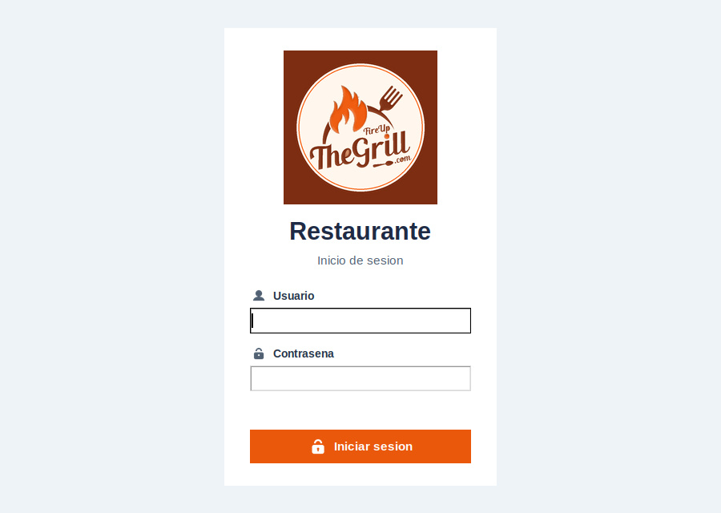
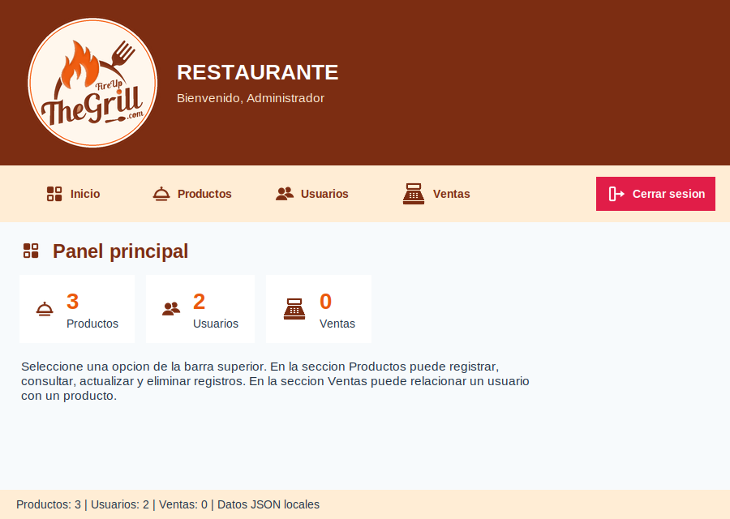
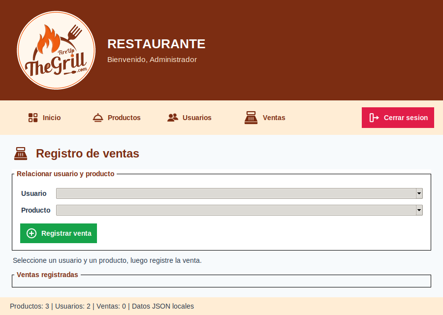
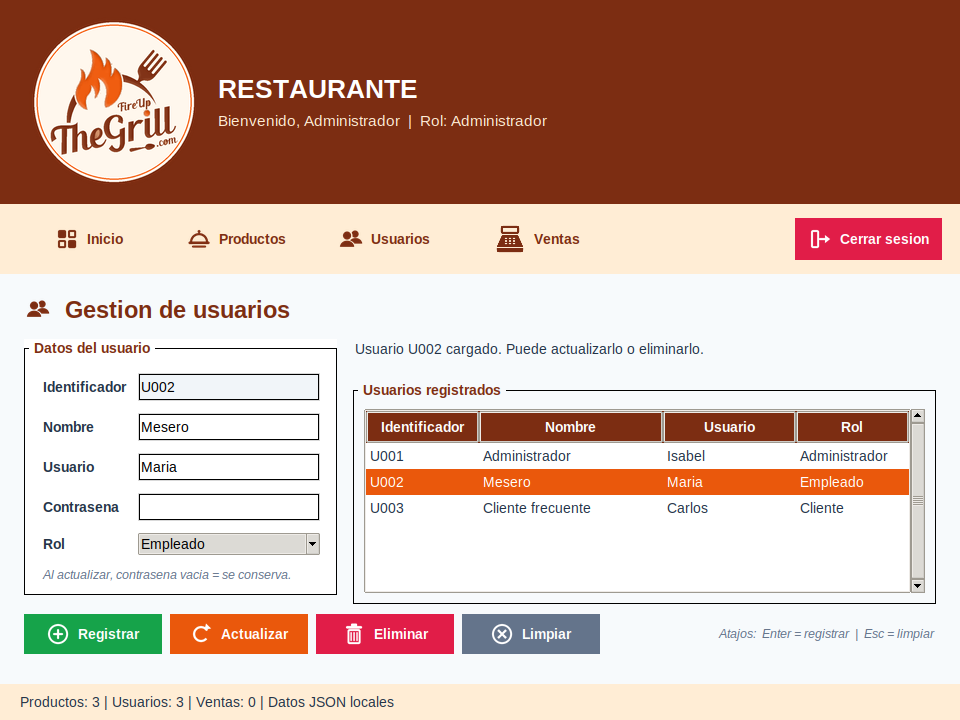
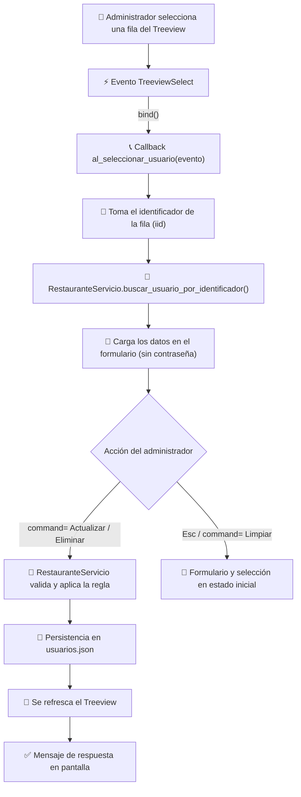

<div align="center">


# 🍔 Restaurante App

### Sistema de gestión para restaurante — Escritorio con Python & Tkinter

**Semana 16 · Programación Orientada a Objetos**
**Tema: Manejo de eventos aplicado a la gestión de usuarios**


</div>

---

## 📌 Propósito de la Semana 16

`restaurante_app` sigue siendo el mismo proyecto de semanas anteriores (inicio de sesión, productos, ventas), sin reconstruirlo. Esta semana se evoluciona **únicamente la sección Usuarios** para aplicar el manejo de eventos en una situación real del sistema:

> Una **selección**, una **tecla** o un **cambio de opción** activan *callbacks* que coordinan la interfaz, mientras que las reglas y la persistencia se quedan en `RestauranteServicio`.

La gestión de usuarios es el contexto práctico; lo central son los eventos `<<TreeviewSelect>>`, `<Return>`, `<Escape>` y `<<ComboboxSelected>>`, junto con la diferencia entre `bind()` y `command=`.

---

## 🖼️ Vista previa

<div align="center">

| Inicio de sesión | Panel principal | Registro de ventas |
|:---:|:---:|:---:|
|  |  |  |

**Nuevo — Gestión de usuarios (solo Administrador)**



</div>

---

## 🧭 Flujo de la interacción



---

## 👥 Gestión de usuarios

Disponible en **Usuarios** (menú superior) para el rol Administrador. Permite **registrar, consultar, actualizar y eliminar** usuarios desde un formulario y un `Treeview` con las columnas *Identificador, Nombre, Usuario y Rol*.

- El **identificador** (`U001`, `U002`…) lo genera el servicio; en el formulario es de solo lectura.
- La **contraseña nunca se muestra** en la tabla ni se carga en el formulario al seleccionar una fila. Al actualizar, si el campo queda vacío se conserva la contraseña actual.
- La tabla guarda el identificador como `iid` de cada fila; el callback lo usa para pedirle el objeto `Usuario` al servicio.
- Cada operación termina con la tabla refrescada, el formulario limpio y un mensaje de éxito o error.

### 🎭 Roles

El modelo `Usuario` incorpora el atributo `rol`, validado y persistido en `usuarios.json`.

| Rol | Qué representa | ¿Gestiona usuarios? |
|---|---|:---:|
| **Administrador** | Administra el sistema | ✅ Sí |
| **Empleado** | Personal del restaurante | ❌ No |
| **Cliente** | Persona que consume en el restaurante | ❌ No |

Reglas aplicadas (sin sistema complejo de permisos):

- Solo el Administrador ve el botón **Usuarios**. Si un Empleado o Cliente llegara a la sección, el servicio rechaza cualquier operación y la pantalla muestra *Acceso restringido*.
- El Administrador registra y modifica usuarios con rol **Empleado** o **Cliente**. Su propia cuenta puede editarla (nombre, usuario o contraseña), pero no cambiar su rol ni eliminarla; el combo de rol se bloquea al seleccionarla.
- La cuenta con la que se inició sesión **no puede eliminarse**.
- El nombre de usuario es único (sin distinguir mayúsculas de minúsculas).
- Los registros antiguos sin `rol` se leen como *Empleado*.

---

## ⚡ Eventos implementados

| Evento | Se conecta con | Callback | Qué hace |
|---|---|---|---|
| `<<TreeviewSelect>>` | `bind()` sobre el `Treeview` | `al_seleccionar_usuario(evento)` | Carga el usuario seleccionado en el formulario |
| `<<ComboboxSelected>>` | `bind()` sobre el `Combobox` de rol | `al_cambiar_rol(evento)` | Responde al cambio mostrando qué significa el rol elegido |
| `<Return>` | `bind()` sobre los campos del formulario | `al_presionar_enter(evento)` | Atajo: llama a `registrar_usuario()` |
| `<Escape>` | `bind()` sobre los campos y la tabla | `al_presionar_escape(evento)` | Atajo: llama a `limpiar_formulario_usuario()` |
| Botones | `command=` | `registrar_usuario`, `actualizar_usuario`, `eliminar_usuario`, `limpiar_formulario_usuario` | Acciones principales |

### `bind()` vs `command=` vs callbacks

- **`command=`** es propio de los botones: ejecuta una función cuando se pulsa. No recibe información del evento.
- **`bind(evento, callback)`** sirve para cualquier widget y cualquier evento (teclado, selección, cambio de combo). El *callback* recibe un objeto `evento` (por ejemplo `evento.widget`).
- Un **callback** es la función que Tkinter invoca al ocurrir el evento. Aquí solo lee la interfaz, delega en el servicio y actualiza la vista.

**Sin duplicar lógica:** `<Return>` y `<Escape>` no reimplementan nada; llaman a los mismos métodos que los botones **Registrar** y **Limpiar**. Así hay un solo lugar donde cambiar el comportamiento.

---

## 🗂️ Estructura del proyecto

---

```
restaurante_app/
├── datos/
│   ├── productos.json
│   ├── usuarios.json        ← ahora incluye el campo "rol"
│   └── ventas.json
├── modelos/
│   ├── producto.py
│   ├── usuario.py           ← atributo rol + validación
│   └── venta.py
├── servicios/
│   ├── archivo_servicio.py
│   └── restaurante_servicio.py   ← CRUD de usuarios, reglas por rol y persistencia
├── ui/
│   ├── iconos.py
│   ├── login_view.py
│   └── main_view.py         ← formulario, Treeview, bind() y callbacks de usuarios
├── assets/                  ← logo, íconos y capturas
└── main.py
```
---

**Separación de responsabilidades**

- **`modelos/usuario.py`** — representa al usuario y valida sus datos, incluido el `rol`.
- **`servicios/restaurante_servicio.py`** — `registrar_usuario`, `actualizar_usuario`, `eliminar_usuario`, `obtener_usuario`, `es_administrador`, `guardar_usuarios`… Contiene las validaciones, las reglas y la escritura de `usuarios.json` a través de `ArchivoServicio`.
- **`ui/main_view.py`** — captura eventos, llama al servicio y refresca la vista. **No lee ni escribe archivos JSON.**

---

## 🚀 Cómo ejecutarlo

```bash
# 1. Clonar el repositorio
git clone <url-de-este-repositorio>
cd <carpeta-del-repositorio>/restaurante_app

# 2. Ejecutar (Tkinter viene incluido con Python)
python main.py
```

**Credenciales de prueba** (definidas en `datos/usuarios.json`):

| Usuario | Contraseña | Rol |
|---|---|---|
| `Isabel` | `1234` | Administrador |
| `Maria` | `frutas123` | Empleado |
| `Carlos` | `cliente123` | Cliente |

**Para probar la gestión de usuarios:**
1. Inicia sesión con `Isabel` y entra a **Usuarios**.
2. Completa nombre, usuario, contraseña y rol, y presiona **Enter** (o el botón **Registrar**).
3. Haz clic en una fila: sus datos se cargan en el formulario (`<<TreeviewSelect>>`).
4. Cambia un dato y pulsa **Actualizar**; elige otro rol en el combo para ver la respuesta de `<<ComboboxSelected>>`.
5. Pulsa **Esc** para limpiar el formulario y la selección.
6. Selecciona un usuario y pulsa **Eliminar** (pide confirmación). Prueba también con tu propia cuenta: no se permite.
7. Cierra y vuelve a abrir la aplicación: los usuarios se recuperan desde `datos/usuarios.json`.
8. Inicia sesión con `Maria` o `Carlos`: el botón **Usuarios** no aparece.

---

## ✅ Funcionalidades

| Módulo | Estado | Descripción |
|---|:---:|---|
| 🔐 Inicio de sesión | ✅ | Autenticación contra `usuarios.json` vía `RestauranteServicio` |
| 🍕 Productos | ✅ | Registrar, consultar, actualizar y eliminar (sin cambios) |
| 💰 Ventas | ✅ | Relacionar un usuario con un producto (sin cambios) |
| 👥 **Usuarios** | ✅ **Evolucionado — Semana 16** | CRUD con `Treeview`, roles y eventos |
| 🎨 Interfaz estilizada | ✅ | Íconos y logo propios en `assets/` |

### Cambios pequeños sobre lo anterior
- El encabezado muestra el rol del usuario conectado.
- `crear_campo()` pasó a ser reutilizable por el formulario de productos y el de usuarios.
- La ventana es un poco más alta (`960x720`) para alojar el formulario de usuarios.

---

## 🧪 Comprobaciones realizadas

Se verificó, ejecutando la interfaz y disparando los eventos reales de Tkinter:

- Inicio de sesión, navegación, Productos y Ventas siguen funcionando.
- Administrador accede a Usuarios; Empleado y Cliente no ven la sección ni pueden operar sobre usuarios.
- Registro de Cliente y Empleado; aparecen en el `Treeview` y en `usuarios.json`.
- `<<TreeviewSelect>>` carga los datos en el formulario (sin contraseña).
- Actualizar conserva los cambios (y la contraseña si se deja vacía).
- Eliminar pide confirmación; la cuenta autenticada no puede eliminarse.
- `<Return>` registra (también desde el Combobox); `<Escape>` limpia formulario y selección (también desde la tabla).
- `<<ComboboxSelected>>` responde al cambio de rol.
- Al reiniciar, los usuarios y sus roles se recuperan desde `usuarios.json`.

---

## 🛠️ Tecnologías

<div align="center">


</div>

---

## 📚 Alcance de la Semana 16

Conforme a la guía, **no** se implementaron bloqueo o suspensión de cuentas, recuperación de contraseña, permisos avanzados, base de datos, cifrado ni administración compleja de roles. Las contraseñas se guardan tal como en las semanas anteriores.

<div align="center">

---
Proyecto académico — Programación Orientada a Objetos · Semana 16

</div>
